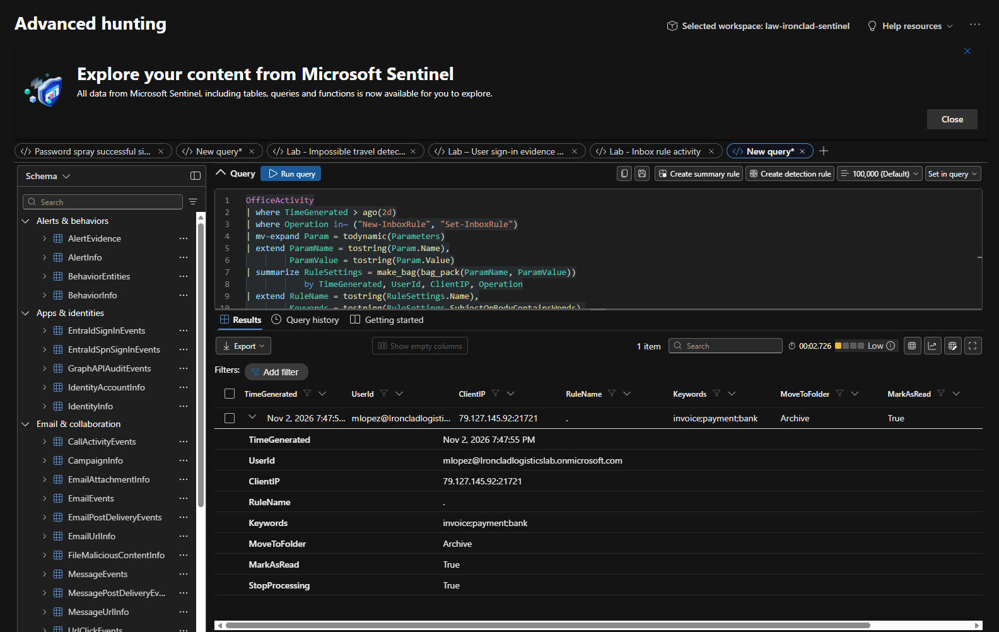
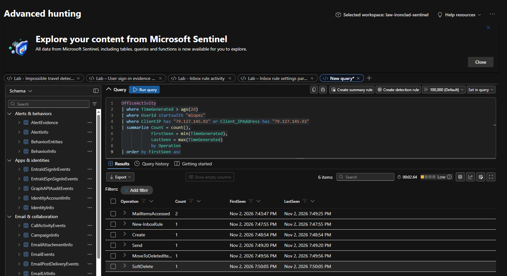
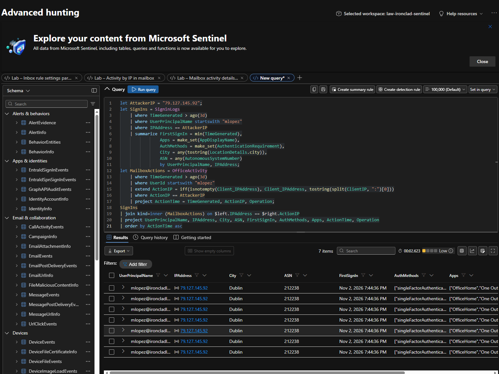

# Scenario 3 — Business Email Compromise (BEC)

**MITRE ATT&CK:** [T1078.004](https://attack.mitre.org/techniques/T1078/004/) (Valid Accounts) · [T1114.002](https://attack.mitre.org/techniques/T1114/002/) (Remote Email Collection) · [T1564.008](https://attack.mitre.org/techniques/T1564/008/) (Email Hiding Rules) · [T1534](https://attack.mitre.org/techniques/T1534/) (Internal Spearphishing)

---

## Summary

An attacker signed in as **Maria Lopez (Accounts Payable)** with her password from a **datacenter IP** and ran a full BEC in ~6 minutes: read her mail, created a hidden inbox rule to divert anything mentioning *invoice/payment/bank* to Archive, emailed the CFO a fraudulent "vendor banking update," and deleted the evidence from Sent and Deleted Items. The CFO's reply was silently hidden by the rule.

I investigated **entirely from logs**, correlated the sign-in to every mailbox action with a KQL **join**, scoped the attacker infrastructure tenant-wide by **ASN**, and responded with Exchange Online and Microsoft Graph PowerShell.

> **Root cause:** Maria *had* MFA registered, but it **wasn't enforced** — the sign-in was `singleFactorAuthentication`. A password alone gave full mailbox access. This is one of the most common real-world gaps and the same root cause as Scenarios 1 and 2.

**Verdict:** True positive — confirmed account compromise and BEC.

---

## Hunt

### Query 1 — find inbox-rule activity

```kql
OfficeActivity
| where TimeGenerated > ago(2d)
| where Operation in~ ("New-InboxRule", "Set-InboxRule", "UpdateInboxRules")
| project TimeGenerated, UserId, Operation, ClientIP, Parameters, ResultStatus
| order by TimeGenerated asc
```

- `OfficeActivity` is the Microsoft 365 unified audit log (Exchange/SharePoint/Teams) — same data as Purview Audit, queryable in KQL.
- Three operation names because the logged name depends on *how* the rule was made (OWA vs. desktop vs. PowerShell/API) — covering all three avoids blind spots.
- `in~` = case-insensitive match.

**Result:** `mlopez` created rule `.` from the attacker IP. The rule settings sit in `Parameters` as JSON.

### Query 2 — parse the rule's settings out of nested JSON

```kql
OfficeActivity
| where TimeGenerated > ago(2d)
| where Operation in~ ("New-InboxRule", "Set-InboxRule")
| mv-expand Param = todynamic(Parameters)
| extend ParamName = tostring(Param.Name), ParamValue = tostring(Param.Value)
| summarize RuleSettings = make_bag(bag_pack(ParamName, ParamValue))
            by TimeGenerated, UserId, ClientIP, Operation
| extend RuleName   = tostring(RuleSettings.Name),
         Keywords   = tostring(RuleSettings.SubjectOrBodyContainsWords),
         MoveTo     = tostring(RuleSettings.MoveToFolder),
         MarkAsRead = tostring(RuleSettings.MarkAsRead)
| project TimeGenerated, UserId, ClientIP, RuleName, Keywords, MoveTo, MarkAsRead
```

`mv-expand` → `make_bag(bag_pack(...))` turns a messy JSON list into one readable row. (Same pattern works for OAuth permissions, CA details, alert evidence — any nested JSON.)

**Result:** one row — rule `.`, keywords `invoice;payment;bank`, MoveToFolder `Archive`, MarkAsRead `True`. Every part is a BEC red flag.



### Query 3 — pivot: everything that IP did in the mailbox

```kql
OfficeActivity
| where TimeGenerated > ago(2d)
| where UserId startswith "mlopez"
| where ClientIP has "<attacker_ip>" or Client_IPAddress has "<attacker_ip>"
| summarize Count = count(), FirstSeen = min(TimeGenerated), LastSeen = max(TimeGenerated) by Operation
| order by FirstSeen asc
```

- `has` matches the IP whole-term (OfficeActivity stores a `:port` suffix that would break `==`).
- Two IP columns (`ClientIP` / `Client_IPAddress`) — different M365 services log to different ones, so check both.
- No operation filter — this returns **everything** the attacker IP did; Microsoft already labels each row's `Operation`.

**Result — the attack timeline:** MailItemsAccessed → New-InboxRule → Create (draft) → Send → MoveToDeletedItems → SoftDelete. ~6 minutes, first access to covering tracks.



> Mailbox **search** events were missing — search auditing isn't on by default. *You can only investigate what you log.* Deletes were **SoftDelete** (recoverable via eDiscovery), not a hard purge.

### Query 5 — the join: prove one session did everything

Two tables, two halves of the story → join on IP to prove it was the same session (like a VLOOKUP).

```kql
let AttackerIP = "<attacker_ip>";
let SignIns = SigninLogs
    | where TimeGenerated > ago(3d)
    | where UserPrincipalName startswith "mlopez"
    | where IPAddress == AttackerIP
    | summarize FirstSignIn = min(TimeGenerated),
                Apps = make_set(AppDisplayName),
                AuthMethods = make_set(AuthenticationRequirement),
                City = any(tostring(LocationDetails.city)),
                ASN = any(AutonomousSystemNumber)
                by UserPrincipalName, IPAddress;
let MailboxActions = OfficeActivity
    | where TimeGenerated > ago(3d)
    | where UserId startswith "mlopez"
    | extend ActionIP = iff(isnotempty(Client_IPAddress), Client_IPAddress, tostring(split(ClientIP, ":")[0]))
    | where ActionIP == AttackerIP
    | project ActionTime = TimeGenerated, ActionIP, Operation;
SignIns
| join kind=inner (MailboxActions) on $left.IPAddress == $right.ActionIP
| project UserPrincipalName, IPAddress, City, ASN, FirstSignIn, AuthMethods, Apps, ActionTime, Operation
| order by ActionTime asc
```

- Sign-ins summarized to one row first (avoids join duplication).
- The `iff(... split(ClientIP, ":")[0])` normalizes the IP so the two tables match — stripping the port and picking the right column. **Normalizing data before a join is most of the real work.**

**Result:** every mailbox action tied to one sign-in — datacenter ASN, `singleFactorAuthentication`. Case proven from logs alone.



### Query 7 — scope the attacker infrastructure tenant-wide (by ASN)

Attackers rotate IPs; hunt the **network (ASN)** instead.

```kql
SigninLogs
| where TimeGenerated > ago(7d)
| where AutonomousSystemNumber in (212238, 9009)   // datacenter ASNs seen in the attacks
| summarize SignIns = count(), Users = make_set(UserPrincipalName),
            IPs = make_set(IPAddress), Results = make_set(ResultType)
            by AutonomousSystemNumber
| order by SignIns desc
```

**Result:** the same datacenter ASN touched the CEO *and* AP accounts — in a real case, evidence of a campaign targeting finance/leadership. (It also surfaced my own admin account on the VPN — a lesson in not contaminating investigation data by leaving a VPN connected.)

---

## Response (PowerShell / Microsoft Graph)

Documented in a transcript. Containment order matters: **block → reset → revoke → verify → unblock.**

```powershell
# Exchange Online — document before deleting, then remove only the malicious rule
Get-InboxRule -Mailbox mlopez@... | Format-List Name, SubjectOrBodyContainsWords, MoveToFolder, MarkAsRead
Get-Mailbox mlopez@... | Format-List ForwardingSmtpAddress, ForwardingAddress   # check forwarding persistence
Get-InboxRule -Mailbox mlopez@... | Where-Object { $_.Name -eq "." } | Remove-InboxRule -Confirm:$false

# Microsoft Graph — contain the account
Update-MgUser -UserId mlopez@... -AccountEnabled:$false          # block first (close the re-entry gap)
Update-MgUser -UserId mlopez@... -PasswordProfile $PasswordProfile
Revoke-MgUserSignInSession -UserId mlopez@...                    # kill existing tokens
Get-MgUserAuthenticationMethod -UserId mlopez@... | ...          # check for attacker-added MFA
Update-MgUser -UserId mlopez@... -AccountEnabled:$true           # re-enable once clean
```

- A password reset alone doesn't end issued tokens — **revoke sessions too**.
- Verified no attacker MFA persistence by cross-checking `AuditLogs` registration events (Graph left `CreatedDateTime` blank — *when one tool falls short, verify with another source*).
- Graph permissions are two layers: your Entra role **and** the session scopes must both allow the action (`User.ReadWrite.All` does **not** include password reset — needs `User-PasswordProfile.ReadWrite.All`).

---

## Lessons

- No single table tells the story: `SigninLogs` (how in) + `OfficeActivity` (what they did) + `EmailEvents` (who they emailed) + `AuditLogs` (persistence). **Joins turn events into stories.**
- Audit logs hold metadata, not message bodies — recipients/subjects yes, content via eDiscovery.
- Hunt infrastructure (ASN), not just single IPs.
- **MFA registered ≠ MFA enforced** — the root cause fixed in Scenario 4.
